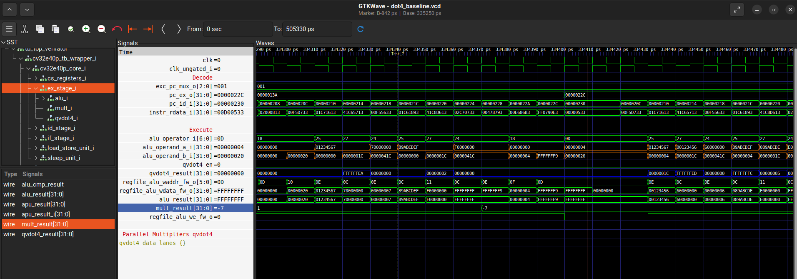
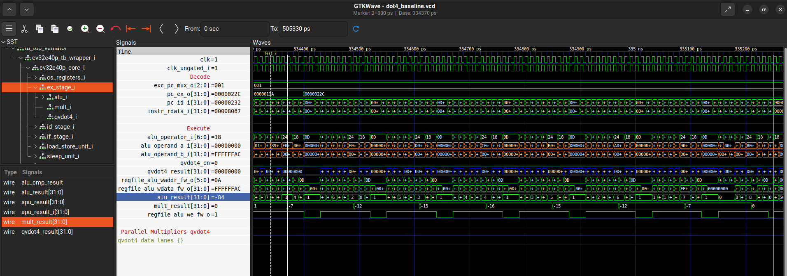
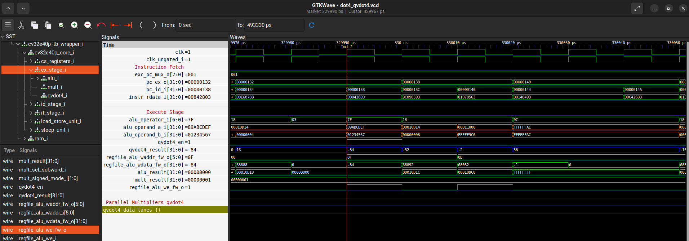
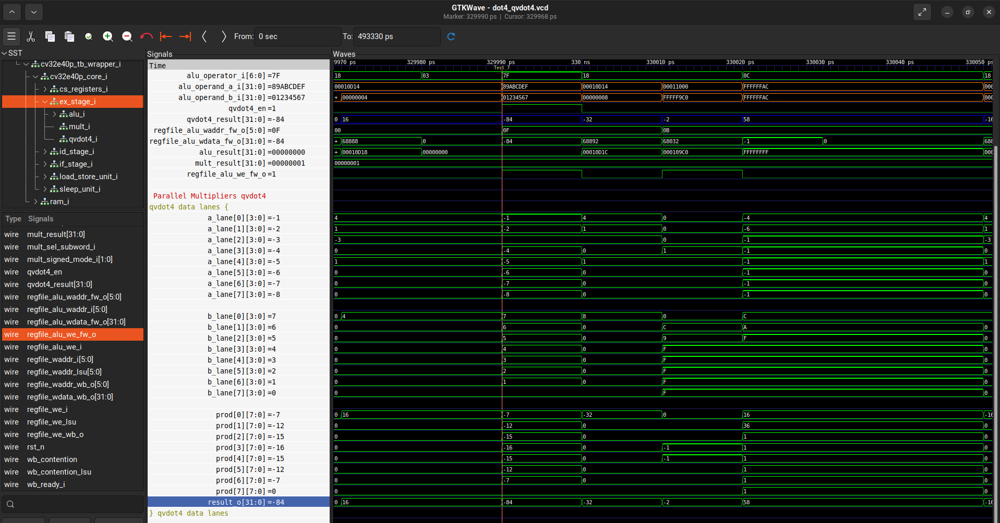

# 4-bit SIMD MAC Instruction for TinyML on RISC-V

Hardware-software co-design of a custom RISC-V instruction (`qvdot4`) that computes a packed 8-lane signed 4-bit dot product in a single execution cycle on the OpenHW Group CV32E40P core.

## Repository Structure

- `src/main.cc` + `src/model_full.cc` — TensorFlow Lite Micro LeNet-5 inference workload, built as a static RV32 ELF and run under gem5 syscall emulation.
- `scripts/validate_tflite_reference.py` — Validates the gem5 RV32 LeNet-5 output against a desktop Python TFLite reference run.
- `src/dot4_baseline.c` — Software baseline microbenchmark for the packed 8-lane signed 4-bit dot product (`qvdot4_sw`).
- `src/dot4-qvdot4.c` — Hardware-accelerated microbenchmark using the custom `qvdot4` instruction (`.insn r 0x0b, 0, 0, rd, rs1, rs2`).
- `src/rtl/` — Modified CV32E40P RTL files implementing the `qvdot4` functional unit (`cv32e40p_qvdot4.sv`, `include/cv32e40p_pkg.sv`, `cv32e40p_decoder.sv`, `cv32e40p_ex_stage.sv`, `cv32e40p_manifest.flist`).

All commands below are run from the repository root unless stated otherwise.

## Prerequisites

```bash
export RISCV_PREFIX=riscv64-unknown-elf-   # RV32 / ilp32 capable
export GEM5_ROOT=/path/to/gem5             # built with RISC-V support, gem5 25.x
export CORE_V_VERIF=/path/to/core-v-verif  # CV32E40P + Verilator flow
```

Also required:

- TensorFlow Lite Micro checked out at `tflite-micro/`, with the RV32 static library
  at `tflite-micro/gen/riscv32_generic_rv32im_default_gcc/lib/libtensorflow-microlite.a`.
- Python with `numpy` and a TFLite interpreter (`tflite-runtime`, `ai-edge-litert`, or
  `tensorflow`) for the reference validation.

## 1. LeNet-5 Baseline Profiling and Reference Validation (gem5)

Build and run the TFLite Micro LeNet-5 model on gem5:

```bash
mkdir -p out
${RISCV_PREFIX}g++ \
  -march=rv32im -mabi=ilp32 -O2 -DNDEBUG \
  -DTF_LITE_STATIC_MEMORY -DTF_LITE_MCU_DEBUG_LOG \
  -fno-rtti -fno-exceptions -fno-threadsafe-statics \
  -I./tflite-micro \
  -I./tflite-micro/tensorflow \
  -I./tflite-micro/tensorflow/lite/micro/tools/make/downloads/flatbuffers/include \
  -I./tflite-micro/tensorflow/lite/micro/tools/make/downloads/gemmlowp \
  -I./tflite-micro/tensorflow/lite/micro/tools/make/downloads/ruy \
  src/main.cc src/model_full.cc \
  tflite-micro/gen/riscv32_generic_rv32im_default_gcc/lib/libtensorflow-microlite.a \
  -lm -static -o out/baseline_inference.elf
```

Use `-march=rv32imc` if the TFLM library was built with compressed instructions.

Run:

```bash
$GEM5_ROOT/build/ALL/gem5.opt \
  --outdir=out/m5out_baseline --redirect-stdout \
  src/run_inference.py --binary out/baseline_inference.elf
```

gem5 options go before `src/run_inference.py`; `--binary` goes after it.

The run succeeded when the output reaches `Checkpoint 5: Inference Complete!`.
Results land in `out/m5out_baseline/` (`stats.txt`, `config.ini`, `simout`).

Extract metrics:

```bash
python3 scripts/parse_gem5_stats.py out/m5out_baseline/stats.txt \
  --label baseline_lenet_rv32 --output out/gem5_summary.csv
```

## 1.1 Validate TFLite output reference

Compares the RV32 scores against a desktop TFLite interpreter running the same model
bytes extracted from `src/model_full.cc`, with the same zero-filled input.

```bash
python3 scripts/validate_tflite_reference.py --gem5-log out/m5out_baseline/simout.txt
```

Exit status 0 means PASS. Reference scores (zero input):
`19,39,97,246,11,292,19,15,203,46`.

## Baseline metrics
## 2.1 dot4 baseline on gem5

```bash
${RISCV_PREFIX}gcc -march=rv32im -mabi=ilp32 -O2 -DNDEBUG \
  -DDOT4_ITERATIONS=100000 \
  src/dot4_baseline.c -lm -static -o out/dot4_baseline.elf

$GEM5_ROOT/build/ALL/gem5.opt \
  --outdir=out/m5out_dot4_baseline --redirect-stdout \
  src/run_inference.py --binary out/dot4_baseline.elf
```

Expect `RESULT PASS`, `failures=0`, checksum `-247872`. gem5 uses a generic
`TimingSimpleCPU`, so it is used for correctness and profiling only — no cycle figure
for dot4 is claimed from gem5.

## 2.2 dot4 baseline on CV32E40P

Place the program at `$CORE_V_VERIF/cv32e40p/tests/programs/custom/dot4_baseline/`,
then:

```bash
cd $CORE_V_VERIF/cv32e40p/sim/uvmt
make test TEST=dot4_baseline SIMULATOR=verilator
```

The benchmark reads the `mcycle` CSR around the loop. The run is correct when the log
reports `RESULT PASS`, `failures=0`, checksum `-247872`, and `EXIT SUCCESS`.

## 2.3 Baseline results

CV32E40P (core-v-verif, Verilator) — the authoritative cycle baseline:

| Metric | Value |
| --- | --- |
| Iterations | 100000 |
| Checksum | -247872 |
| Failures | 0 |
| MCYCLE delta | 11300011 |
| Cycles per dot4 | 113.000 |
| Result | PASS |

gem5 dot4: PASS, same checksum `-247872`, 0 failures. Cycle counts not recorded.

Deterministic vectors, identical on both platforms:

```text
zero            0x00000000 * 0x11111111 =    0
all_ones        0x11111111 * 0x11111111 =    8
all_minus_one   0xFFFFFFFF * 0x11111111 =   -8
max_positive    0x77777777 * 0x11111111 =   56
min_negative    0x88888888 * 0x11111111 =  -64
min_squared     0x88888888 * 0x88888888 =  512
mixed           0x89ABCDEF * 0x01234567 =  -84
```

`qvdot4` speedup will be measured against the 113.000 cycles/dot4 CV32E40P figure.

## 3. Custom Instruction (`dot4-qvdot4`) on CV32E40P

Copy the modified RTL files from `src/rtl/` into `$CORE_V_VERIF/core-v-cores/cv32e40p/` and copy `src/dot4-qvdot4.c` into `$CORE_V_VERIF/cv32e40p/tests/programs/custom/dot4-qvdot4/dot4-qvdot4.c`. Rebuild the Verilator model and run:

```bash
cd $CORE_V_VERIF/cv32e40p/sim/core
make veri-clean
make veri-test TEST=dot4-qvdot4
```

## 4. Functional Verification Results (7 Directed Test Vectors)

Each 32-bit operand holds eight signed 4-bit two's-complement lanes (Lanes 7..0 shown from MSB `[31:28]` to LSB `[3:0]`):

| Test Case | Operand A (Hex) | Operand A Lanes (Decimal) | Operand B (Hex) | Operand B Lanes (Decimal) | Expected | Baseline | `qvdot4` | Status |
| --- | --- | --- | --- | --- | --- | --- | --- | --- |
| `zero` | `0x00000000` | `[0, 0, 0, 0, 0, 0, 0, 0]` | `0x11111111` | `[1, 1, 1, 1, 1, 1, 1, 1]` | `0` | `0` | `0` | `PASS` |
| `all_ones` | `0x11111111` | `[1, 1, 1, 1, 1, 1, 1, 1]` | `0x11111111` | `[1, 1, 1, 1, 1, 1, 1, 1]` | `8` | `8` | `8` | `PASS` |
| `all_minus_one` | `0xFFFFFFFF` | `[-1, -1, -1, -1, -1, -1, -1, -1]` | `0x11111111` | `[1, 1, 1, 1, 1, 1, 1, 1]` | `-8` | `-8` | `-8` | `PASS` |
| `max_positive` | `0x77777777` | `[7, 7, 7, 7, 7, 7, 7, 7]` | `0x11111111` | `[1, 1, 1, 1, 1, 1, 1, 1]` | `56` | `56` | `56` | `PASS` |
| `min_negative` | `0x88888888` | `[-8, -8, -8, -8, -8, -8, -8, -8]` | `0x11111111` | `[1, 1, 1, 1, 1, 1, 1, 1]` | `-64` | `-64` | `-64` | `PASS` |
| `min_squared` | `0x88888888` | `[-8, -8, -8, -8, -8, -8, -8, -8]` | `0x88888888` | `[-8, -8, -8, -8, -8, -8, -8, -8]` | `512` | `512` | `512` | `PASS` |
| `mixed` | `0x89ABCDEF` | `[-8, -7, -6, -5, -4, -3, -2, -1]` | `0x01234567` | `[0, 1, 2, 3, 4, 5, 6, 7]` | `-84` | `-84` | `-84` | `PASS` |

## 5. Cycle-Accurate Performance Comparison on CV32E40P (`core-v-verif` + Verilator)

| Metric | Software Baseline (`dot4-baseline`) | Custom ISA (`dot4-qvdot4`) | Improvement |
| --- | --- | --- | --- |
| Iterations | `100,000` | `100,000` | — |
| Checksum | `-247872` | `-247872` | Exact match |
| Failures | `0` | `0` | — |
| `mcycle` Start | `39,054` | `38,539` | — |
| `mcycle` End | `11,339,065` | `1,038,550` | — |
| `mcycle` Delta (Total Cycles) | `11,300,011` | `1,000,011` | `-10,300,000` cycles (`-91.15%`) |
| Cycles per `dot4` Iteration | `113.000` | `10.000` | `11.30x` loop speedup |
| Pure `dot4` Kernel Cycles (excl. 9-cycle loop/PRNG overhead) | `104` | `1` | `104.0x` kernel speedup |
| Verification Status | `PASS` | `PASS` | — |

## 6. Standalone 4-bit LeNet-5 CNN Benchmark on CV32E40P (`lenet5-qvdot4`)

All 10 output class logits (`Class 0..9`: `-68, 19, -79, -34, 2, 55, -41, -17, 12, -21`, top class `5`, checksum `-588`) match identically between software and the custom `qvdot4` hardware instruction (`RESULT PASS failures=0`).

| LeNet-5 Layer | Packed `dot4` Calls | SW Baseline Cycles | Custom `qvdot4` Cycles | Cycle Reduction | Layer Speedup |
| --- | ---: | ---: | ---: | ---: | ---: |
| `Conv1` (`28x28x6`, `5x5x1`) | `18,816` | `2,320,609` | `406,049` | `-82.50%` | `5.72x` |
| `Pool1` (`14x14x6`, `2x2` avg) | `0` | `52,172` | `60,388` | — | `0.86x` |
| `Conv2` (`10x10x16`, `5x5x6`) | `30,400` | `3,664,981` | `424,795` | `-88.41%` | `8.63x` |
| `Pool2` (`5x5x16`, `2x2` avg + pack) | `0` | `26,587` | `27,860` | — | `0.95x` |
| `FC1` (`400 -> 120`) | `6,000` | `694,794` | `77,812` | `-88.80%` | `8.93x` |
| `FC2` (`120 -> 84`) | `1,260` | `150,891` | `19,165` | `-87.30%` | `7.87x` |
| `FC3` (`84 -> 10`) | `110` | `13,227` | `1,499` | `-88.67%` | `8.82x` |
| **MAC Layers Subtotal** | **`56,586`** | **`6,844,502`** | **`929,320`** | **`-86.42%`** | **`7.37x`** |
| **Total End-to-End LeNet-5** | **`56,586`** | **`6,923,261`** | **`1,017,568`** | **`-85.30%`** | **`6.80x`** |

## 7. Normalized Comparison: `dot4` Microbenchmark vs. LeNet-5 Layers (Cycles per `dot4` Call)

| Benchmark / Layer | `dot4` Calls | SW Cycles / `dot4` | HW Cycles / `dot4` | Cycles Saved / `dot4` | Speedup |
| --- | ---: | ---: | ---: | ---: | ---: |
| **Isolated `dot4` Microbenchmark** | `100,000` | **`113.000`** | **`10.000`** | **`103.000`** | **`11.30x`** |
| **Pure `dot4` Kernel (excl. 9-cycle harness)** | `100,000` | **`104.000`** | **`1.000`** | **`103.000`** | **`104.00x`** |
| LeNet-5 `Conv1` (`28x28x6`) | `18,816` | `123.332` | `21.580` | `101.752` | `5.72x` |
| LeNet-5 `Conv2` (`10x10x16`) | `30,400` | `120.559` | `13.974` | `106.585` | `8.63x` |
| LeNet-5 `FC1` (`400 -> 120`) | `6,000` | `115.799` | `12.969` | `102.830` | `8.93x` |
| LeNet-5 `FC2` (`120 -> 84`) | `1,260` | `119.755` | `15.210` | `104.544` | `7.87x` |
| LeNet-5 `FC3` (`84 -> 10`) | `110` | `120.245` | `13.627` | `106.618` | `8.82x` |
| **LeNet-5 MAC Layers Combined** | **`56,586`** | **`120.958`** | **`16.423`** | **`104.534`** | **`7.37x`** |
| **Full LeNet-5 (incl. `Pool1` & `Pool2`)** | **`56,586`** | **`122.349`** | **`17.983`** | **`104.367`** | **`6.80x`** |

- **Consistent per-call savings (`~103–104.5` cycles):** Across all `56,586` `dot4` calls in LeNet-5, `qvdot4` saves an average of `104.534` cycles per `dot4` call, matching the `103.000` cycles saved per call in the isolated microbenchmark (plus ~`1.5` cycles saved from eliminating `qvdot4_sw` function-call/register-spill overhead in nested loops).
- **Amortization of outer-loop overhead:** As the number of packed words per neuron increases from `4` (`Conv1`) to `19` (`Conv2`) and `50` (`FC1`), outer-loop bias, ReLU, bit-shift scaling, and 4-bit clamping are amortized over more `dot4` calls, causing the hardware cycle cost per `dot4` to drop from `21.580` (`Conv1`) to `13.974` (`Conv2`) and `12.969` (`FC1`), approaching the `10.000`-cycle microbenchmark floor.

## 8. Waveform References (GTKWave)
### Software Baseline (`dot4-baseline`)
Executes 8 loop iterations of shift, sign-extension, multiply, and accumulate instructions (~104 clock cycles) while `qvdot4_en` remains `0
`:



### Custom Instruction (`dot4-qvdot4`)
Asserts `qvdot4_en = 1` (`alu_operator_i = 0x7F`) and computes the packed 8-lane signed 4-bit dot product in a single clock cycle:



